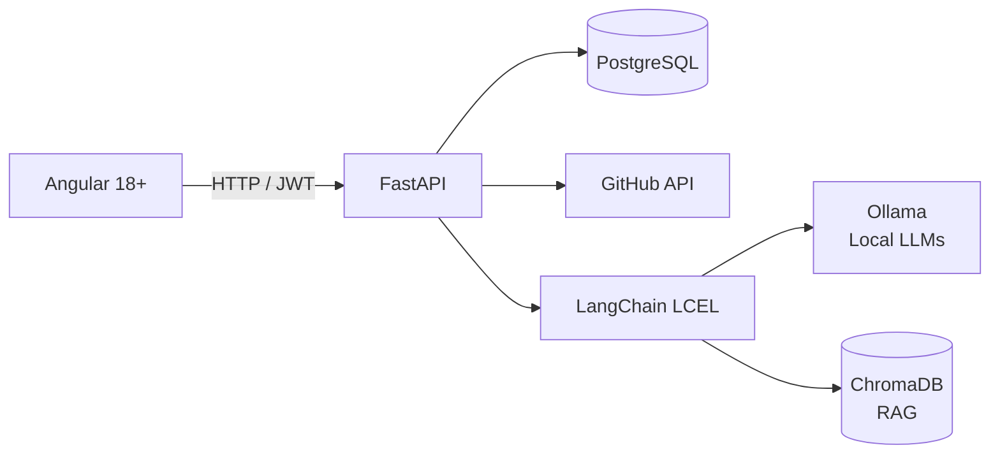

# ProjectInsight AI

An AI-powered platform that helps instructors supervise student integration projects: GitHub activity tracking for teams and automated LLM code reviews, **100% local** (no data sent to any external API).

> Project developed during my R&D internship at ESPRIT.

## Features

- **Team tracking**: each student's contributions (commits, pull requests) computed live from the GitHub API
- **AI code review**: analysis of pasted or uploaded code with a local LLM, returning a quality score, severity, description, and suggested fix for each issue
- **Educational explanations (RAG)**: critical and high-severity issues are enriched with a student-friendly explanation, generated from a knowledge base of 27 teaching sheets
- **Automatic fix (`/fix`)**: generation of the corrected file, validated by a syntax guardrail (`ast.parse()` + 1 automatic retry)
- **Pull Request review**: file-by-file diff analysis followed by a global summary (score, recurring issues), available read-only to the instructor
- **Review history**: every finding is saved (PostgreSQL) and vectorized (ChromaDB)
- **Role-based access**: Admin, Teacher, Student (JWT)
- **GitHub OAuth login**: each student links their account so contributions can be attributed
- **Class and team management**: class and team creation, Team Leader selection, repository connection

## Architecture



Backend organized in strict layers: `routes → services → repositories → models`, with Pydantic schemas kept separate from SQLAlchemy models.

## AI Module

### LangChain Pipelines (LCEL)

Every AI feature follows the same pattern: `Prompt | ChatOllama | Parser`.

- **`PydanticOutputParser`**: forces the LLM output to match a Pydantic schema
- **`OutputFixingParser`**: if the JSON is malformed, a correction call (1 attempt max) prevents the request from failing
- **`RecursiveCharacterTextSplitter`**: splits large Pull Request diffs before analysis

### Educational RAG

```
27 Markdown sheets → vectorization (nomic-embed-text) → ChromaDB index
→ similarity search (from a finding) → injection into the prompt
→ DeepSeek-Coder-V2 16B → EducationalEnrichment
```

- Knowledge base: 27 sheets (Security 7, Maintainability 7, Code Quality 7, Performance 5), in a fixed format: bad example / good example / how to fix / common mistakes / explanation / related concepts
- Only `critical` and `high` findings are enriched (cost / performance trade-off)
- A second ChromaDB index stores the history of detected findings

### Guardrails

- **Separation of responsibilities**: the LLM only generates the educational text (`EducationalEnrichment`). Finding metadata (severity, title, lines) is re-injected by Python code and never regenerated by the LLM
- **Syntax guardrail**: the corrected code is validated with `ast.parse()` (Python), with one automatic retry, then an explicit warning if the error persists
- **`/analyze` and `/fix` separation**: two distinct LLM calls, one task at a time

### Models (Ollama)

| Model | Role |
|---|---|
| Qwen2.5-Coder 7B | Standard code review (default model) |
| DeepSeek-Coder-V2 16B | RAG educational enrichment (accuracy first) |
| nomic-embed-text | Embeddings for ChromaDB |
| CodeLlama 7B | Reserved for a future security scan feature |

## Tech Stack

| Layer | Technologies |
|---|---|
| Frontend | Angular 18+, TypeScript (strict), Tailwind CSS |
| Backend | Python, FastAPI, SQLAlchemy, Pydantic |
| Database | PostgreSQL |
| Authentication | JWT, GitHub OAuth |
| AI | Ollama, LangChain (LCEL), Qwen2.5-Coder, DeepSeek-Coder-V2, CodeLlama |
| RAG | ChromaDB, nomic-embed-text |
| Static analysis (benchmark) | Pylint, Radon, Bandit |

## Repositories

| Part | Folder | Repository |
|---|---|---|
| Backend (API) | [`backend/`](./backend) | [ProjectInsightBackEnd](https://github.com/HamzagithubNouri/ProjectInsightBackEnd) |
| Frontend (Angular) | [`frontend/`](./frontend) | [ProjectInsightFrontend](https://github.com/HamzagithubNouri/ProjectInsightFrontend) |
